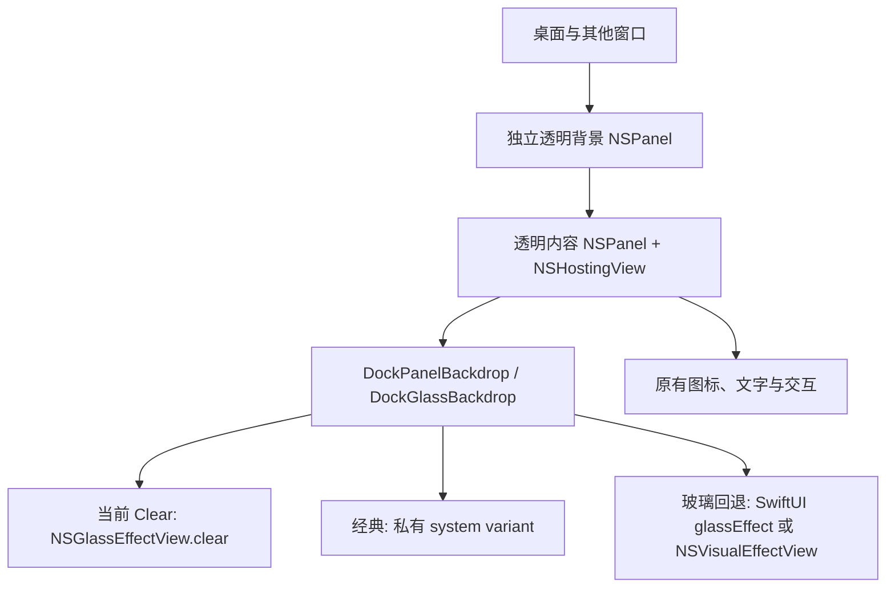

# Liquid Glass 渲染链路调查与原生材质对照

日期：2026-10-21（Asia/Shanghai）；关联工单 WG-018，延续 WG-014。

**最新交付见第 11 节，上游取证见第 10 节**：用户认可私有变体 3，并要求仅保留“经典玻璃 / 私有变体 3”两个背景按钮。已删除其余公开材质、外观、层级和变体11实验代码及入口；前文记录和旧脚本路径作为历史证据保留，不代表这些实验仍可运行。两个保留方案共用上游 variant setter，区别在于是否启用作者的折射/高光增强。

## 结论与证据边界

用户描述的“像过曝一样”指第三张白成一片、玻璃轮廓丢失的视觉表现。本轮目标是恢复浅色背景上的柔和灰色层次，以及深色背景上的背景抑制与纵深，不以提高透明度作为唯一目标。

**已确认**：当前 Clear 路径不是一块完全隔离、无兼容处理的公开玻璃。它有独立的背景窗口、低 alpha 毛玻璃订阅层和保持活动外观的私有兼容钩子。Clear 路径本身没有启用经典模式的自定义折射、高光增强或手画亮边；“参数存在”不等于“当前 Clear 使用了它”。

**推测**：Clear 缺少 Regular 的背景自适应处理，与“白底融为一体、深底文字直接穿透”吻合；宿主活动状态、独立背景窗及系统材质版本也可能影响最终结果。尚未证明这些因素各自贡献多大，不能把某个叠层当作唯一原因。

**未验证**：没有读取系统 Dock 私有视图树或其实际材质参数；没有以同一桌面内容和同一尺寸现场拍摄新实验结果。截图、代码检查、API 属性测试、窗口列表和构建通过均不能替代真实桌面效果确认。

## 1. 用户提供的四张截图

顺序为：原生浅背景、原生深背景、钨极浅背景、钨极深背景。第三张最明显的问题是底板与白底融合；第四张能辨认后方文字，边缘折射线较突出。原生图则保持更柔和的底板层次与背景散射。

用 ImageIO/CoreGraphics 转为 sRGB 8-bit，仅在玻璃顶部无图标空白区取样，结果如下。坐标为原图像素 `[x0,y0,x1,y1]`，原点左上。

| 图 | 原图尺寸 | 取样区域 | RGB 中位数 |
| --- | --- | --- | --- |
| 1 原生浅背景 | 1722×386 | `[900,222,1000,232]` | 200 / 200 / 200 |
| 2 原生深背景 | 1784×268 | `[600,106,680,116]` | 56 / 56 / 56 |
| 3 钨极浅背景 | 1336×212 | `[570,40,630,50]` | 255 / 255 / 255 |
| 4 钨极深背景 | 1316×258 | `[570,86,630,96]` | 75 / 75 / 75 |

图 3 所取区域全部像素的三个通道均 ≥250，支持用户“白成一片”的描述。**这些图片背后内容不同，不能由这张表反推 alpha、模糊半径或判断深色图中哪种材质更不透明。** 完整采样数值保存在本地 `build/Diagnostics/glass-screenshot-measurements.json`。

原附件文件名后缀分别为 `afc0bab1…`、`2a0315fd…`、`5639a542…`、`712cd589…`。分析没有编辑原截图。

## 2. 调查时实际运行的实例

- PID：64211；ARM64；bundle ID：`com.caye.macosdockcc.v2.debug`。
- 可执行文件：`build/DerivedData/Build/Products/Debug/macos-dock-cc-v2.app/Contents/MacOS/macos-dock-cc-v2`，属于当前工程 Debug App。
- `sample` 读取到进程已加载的 UUID：`F02878BE-6611-32FF-A788-CB56FE92A047`；版本字段为 0.18.2 / 55。**版本字段不用于证明它运行了新编译内容。**
- 当前保存设置：背景 `clear`；应用外观 `dark`。进程没有 `DOCK_LIQUID_GLASS*` / `DOCK_PANEL_*` 环境变量覆盖。
- 系统：macOS 26.7.1 / 25G241。NSWorkspace 读取 Reduce Transparency=false、Increase Contrast=false。独立探针没有读到 `NSGlassTintAmount` 值；这不能排除其他系统版本内部玻璃偏好。
- WindowServer 同时列出该进程两块 layer=3、alpha=1 的可见窗口，尺寸 565×85 与 605×125，差 40 点，与背景窗和带四边各 20 点透明边的内容窗结构吻合。**窗口列表不能识别内部 NSGlassEffectView 或判断材质色调。**
- 旧进程 stdout/stderr 指向 `/dev/null`，无法回读其启动材质日志。由代码与保存设置推断是 Clear 合成路径，但本轮未对旧进程做视图树注入，不将推断冒充运行时材质读数。

本地环境采样保存在 `build/Diagnostics/glass-environment-before.txt`。本轮没有自动退出或重新启动这个进程。

## 3. 代码确认的链路

| 检查项 | 已确认事实及位置 |
| --- | --- |
| 窗口透明性 | [PanelSetup](../App/Entry/PanelCoordinator+PanelSetup.swift)：`configurePanel` 设置 `isOpaque=false`、背景 clear、`hasShadow=false`、nonactivating/floating。Hosting layer 也设透明。 |
| 层级 | `setupDockPanel` 创建内容窗，`makeTaskbarGlassBackground` 创建独立鼠标穿透背景窗；原生父子窗口组仅负责一起移动，未在此引入材质。 |
| 当前 Clear | [DockGlassBackdrop](../App/Scenes/DockGlassBackdrop.swift)：`DockClearGlassPlate` 使用 `NSGlassEffectView.style=.clear`、`tintColor=nil`。它就是主底板；图标滚动区的 clip 不给底板加白。 |
| 背景窗 | `DockTaskbarLiquidGlassBackgroundView` 有 `.underWindowBackground` 的 `NSVisualEffectView`，alpha=3/255；另有 `.menu` 材质（默认 alpha=0）与压暗/提亮层（默认 0）。这是与玻璃重叠的额外材质，不是另一个全强度 NSGlassEffectView。 |
| 初始配置细节 | 背景视图 init 先保存配置，再调用带“值没变就返回”的 apply，因此首次 apply 的部分根层颜色/圆角设置可能被跳过，后续几何变化才应用。代码事实已记录；不凭此断言它造成整片白底，本轮为保留 A 基线没有改写这段旧行为。 |
| 当前 Clear 边缘 | `usesClearGlass` 使手画 rim、额外 stripShadow 关闭，outset=0，跳过历史外层 clip。可见亮边主要来自系统 Clear 本身，不能笼统归咎于自定义白描边。 |
| 深色选项 | 旧“深色玻璃”是在 Clear 内叠 12% 黑色层。本轮 A/A′/B/C 均不走这个烟色选项，保留它作为独立旧选项。 |
| 经典选项 | 私有 `set_variant:`，配合 `DockGlassRefractionObserver` 改折射与高光；这些修改不在当前 Clear / 新 A′/B/C 材质视图中运行。 |
| SwiftUI 回退 | 私有变体不可用时的旧路径用 `.glassEffect(.clear.tint(...))`，染色默认 0.4；它不是当前公开 Clear 的 tint 值。更旧系统回退 NSVisualEffectView。 |
| 活动外观兼容 | [NonConstrainingPanel](../App/Entry/NonConstrainingPanel.swift)：`DockLiquidGlassPanel` 覆盖 5 个私有 active/key/main appearance 谓词；旧 Clear/经典视图还调用 `_windowChangedKeyState`。这可能影响非激活面板中的材质解析。 |
| 模糊与饱和 | 窗口级 SkyLight blur 默认 0，不调用；回退路径的饱和度增强默认不启用。玻璃内部仍由系统渲染模糊、折射和动态高光。本轮不添加自定义模糊、vibrancy 或新的颜色滤镜。 |
| 多层玻璃 | 标题药丸等局部元素可单独使用系统玻璃，不能将它们的数量误当作整条 Dock 的全尺寸底板数量；新证据会记录每个视图的 frame 供区分。 |
| 系统条件 | macOS <26 没有公开 NSGlassEffectView；显式 `DOCK_LIQUID_GLASS=0` 仍会退回旧材质。Reduce Transparency / Increase Contrast 会影响系统材质，需要每次验收记录。 |

## 4. 最小实验与“原生效果”入口

位置：设置 → 通用 → Dock 背景 → **原生效果**。默认 B，旧的通透、经典、深色选项不被覆盖，选择会保存。

| 实验 | 主底板 | 附加背景窗 | 可控变量 |
| --- | --- | --- | --- |
| A 当前 Clear | 原 `DockClearGlassPlate` | 保留旧订阅层 | 当前链路基线，不调参数 |
| A′ 单层 Clear | 普通公开 NSGlassEffectView，`.clear`，tint=nil | 保留空透明定位窗，隐藏全部附加材质/颜色层 | 清理链路后的 Clear 控制组 |
| B 标准玻璃 | 与 A′ 同一个公开视图工厂，`.regular`，tint=nil，继承外观 | 同 A′ | 相对 A′ **只改 style** |
| C 仅改变外观 | 同 B `.regular` | 同 B | 相对 B **只改 view.appearance**；C 可选 aqua / darkAqua |

A′ 的目的，是不把“清理背景叠层”与“换成 Regular”混成一个原因。A→A′检验旧兼容链路的整体影响，不能归因为某一单层；A′→B 严格比较材质；B→C 严格比较外观。没有同步调整透明度、模糊、染色、高光或描边数值。

[A′/B/C 公开视图工厂](../App/Scenes/DockNativeGlassView.swift) 不调用私有变体、私有 filter 或窗口状态刷新。窗口级 blur 若有环境覆盖，会在单层实验中清零，退出后恢复。支持窗继续用于已有位置联动，但内容全透明，避免改动窗口几何和显隐运动。Dock 和右侧入口使用相同实验。

**重要保留因素**：现有宿主仍可能是 `DockLiquidGlassPanel`，其私有活动外观谓词是 A/A′/B/C 的共享常量，没有为了材质实验重建窗口、改变激活或交互。因此 B 是“公开标准材质视图基线”，不是“整条宿主链路零私有 API”的承诺。这一共享因素仍可能解释与真正系统 Dock 的剩余差异。

未更改图标布局、缩放、排序、底部间距、显隐曲线、命中范围或拖放规则。几何回归测试也比较了实验切换前后的目标帧。

## 5. 运行时取证与验收方法

在“原生效果”下点击 **复制材质证据**：读取当前进程的 App 路径、bundle ID、系统与辅助功能状态、所选实验、窗口实际类/isOpaque/alpha/背景，以及每个 NSGlassEffectView / NSVisualEffectView 的实际 style、tint、appearance、frame、hidden、alpha。它读取真实对象，不只复述保存设置；隐藏窗口也记录。它不读取背后窗口文字，不发网络请求，也不判断视觉是否合格。

建议固定 Dock 尺寸、图标和同一块浅色/深色背景，先 A→A′，再 A′→B，再 B→C；每次截图并复制证据，避免在比较时同时切全局外观或背景内容。C 在固定浅/深外观与继承外观一致时无明显变化也是有效结果，不应靠额外调参强造差异。

2026-10-21 实际验证记录：

- `./Scripts/build_and_run.sh --build` 成功，使用已有 `macos-dock-cc Local Code Signing` 本地证书签名；`codesign --verify --deep --strict` 通过。没有修改 Release 签名，没有覆盖 `/Applications/Tungsten Edge.app`。
- 新构建 App：`/Users/lewis/D盘/Dev/Project/钨极/build/DerivedData/Build/Products/Debug/macos-dock-cc-v2.app`；bundle ID：`com.caye.macosdockcc.v2.debug`。arm64 UUID：`DBB5775E-6D15-3086-A412-590248C46A2C`；x86_64 UUID：`B99D0708-0F05-31F9-8EC6-23FABD2E3870`。
- `AppSettingsStoreTests` 114 项、`PanelGeometryTests` 48 项，合计 **162 项通过、0 失败**。包括实验设置保存、A′→B 的单一 style 差异、B→C 的单一 appearance 差异、真实窗口属性取证，以及既有几何/显隐回归。测试使用独立 `build/UnsignedValidation`，没有替换已签名产物。
- 构建后 PID 64211 仍在运行，路径与上述 App 相同，但其已加载 UUID 是调查时的旧版本；本轮没有退出、重启或声称启动了新 B 路径。需要通过菜单“重启钨极”，再选择“原生效果 → B 标准玻璃”。新 B 预期路径为 `DockGlassBackdrop → DockNativeGlassPlate → NSGlassEffectView.regular`，实际路径可用“复制材质证据”核对。
- 本次功能不新增辅助功能权限需求。使用相同路径、bundle ID 和本地签名证书，通常不需重新授权；若重启后系统不再认可原授权，应在“系统设置 → 隐私与安全性 → 辅助功能”中重新启用这个 Debug App，以系统实际提示为准。
- 构建日志：`/tmp/tungsten-native-glass-build.log`（脚本结果）及 `/tmp/macos-dock-cc-v2-build.log`（Xcode）；测试日志：`/tmp/tungsten-native-glass-tests.log`。`git diff --check` 通过。

**验收状态：已实现并通过构建、签名及相关测试；新效果未在真实桌面上验证，待用户复测。**

## 6. 公开 API 的复刻边界

Apple 公开 Regular / Clear、tint、cornerRadius、appearance 等接口；没有承诺第三方 NSPanel 中的 Regular 与系统 Dock 的私有材质、取样区域、后台分组、内部折射/边缘距离、动态高光和活动状态策略逐像素相同。旧代码中“variant 3 等于 Dock”或“±2”之类注释不是本机本版本的实测证据，本轮不采信为已证明事实。

本轮不通过猜测私有 filter 参数、黑色遮罩或额外模糊层模拟目标。Regular 的系统动态效果仍由 AppKit 提供；“原生效果”是对照入口的名称，不代表已验收为原生 Dock 完全同款。

参考：[Apple WWDC25 — Meet Liquid Glass](https://developer.apple.com/videos/play/wwdc2025/219/)（Regular 的自适应行为、Clear 更透明、避免玻璃叠玻璃及辅助功能影响）；[Apple NSGlassEffectView](https://developer.apple.com/documentation/appkit/nsglasseffectview)。API 也核对了本机 Xcode SDK 的 `NSGlassEffectView.h`。

## 7. Regular 在浅色背景仍深灰：外观来源复查（2026-10-21）

用户确认新 Regular 在深色背景较自然，但白色背景仍深灰。本轮不把上一轮构建通过记为视觉修复成功，也不添加白色遮罩、改变 opacity、模糊或材质参数。

### 六项检查结果

| 检查 | 代码事实 / 本机证据 | 能得出的结论 |
| --- | --- | --- |
| 窗口强制深色 | Dock / 背景 / 右侧入口窗口的配置没有赋值 `appearance = darkAqua`。`DockLiquidGlassPanel` 的私有 active/key/main 谓词控制活动状态，不是浅/深颜色选择。 | 没有发现 Dock 窗口硬编码深色。实际运行中窗口及 hosting 层的属性需复制新版材质证据核对。 |
| SwiftUI 强制深色 | 主 Dock 与入口的 `.environment(\.colorScheme, …)` 仅在旧 `.dark` 背景选项强制 `.dark`，`.native` 传递继承值。未找到 Dock 的 `.preferredColorScheme(.dark)`。抽屉、StackPopup 的局部深色另属其他界面。 | 当前 native/B 不经过旧深色选项的 SwiftUI 强制分支。 |
| B 的 effectiveAppearance | 工厂每次 B 更新都设 `glass.appearance=nil`，并非设定“独立跟随系统”。它继承 hosting view → 窗口 → NSApp。 | `nil` 不等于绕过全局应用主题；宿主或 NSApp 固定深色时，玻璃继承深色。 |
| C 是否污染 B | 保存设置：`nativeGlassExperiment=standard`，`nativeGlassDarkAppearance=true`。只有 C 才把该 Bool 转成固定 Aqua/DarkAqua；B 忽略这个保存值并清除局部覆盖。 | 当前保存选择是 B，C 的深色开关不在 B 中生效；不能把保存的 true 当成活动覆盖。 |
| 其他覆盖 | `AppDelegate` 订阅 `appearanceMode` 并赋值 `NSApp.appearance`；当前应用设置 `com.tungsten.edge.appearance=dark`，因此请求 DarkAqua。旧 `.dark` Clear 的局部 DarkAqua 不在 B 路径。 | 发现的是用户保存的全局固定深色策略，不是无条件深色硬编码。上一轮 B 的“继承外观”描述没有明确区分“继承应用”与“独立跟随系统”，容易误解。 |
| 系统外观 | 全局 `AppleInterfaceStyle=Dark`；自动切换键未设置。独立 AppKit 探针无 app override 时读到 DarkAqua；macOS 26.7.1 / 25G241，Reduce Transparency / Increase Contrast 均 false。 | 当前系统本来也处于深色。即使将钨极改为跟随系统，这一时刻仍是深色基调，不保证白色背景前自动换浅色。 |

本轮开始时运行进程 PID 2257，路径是工程 Debug App，bundle ID `com.caye.macosdockcc.v2.debug`；上述模式选择来自持久设置，未对运行进程做内存注入或声称已读取其内部视图树。新版“复制材质证据”会补充 app override、窗口显式/有效外观，以及玻璃到所有 hosting 祖先的显式/有效外观链；可识别 SwiftUI 桥接层的覆盖。全局外观偏好单独标为 preference，不冒充活动玻璃的 effectiveAppearance。`COverrideActive` 与保存的 C 偏好分开记录。

### 系统外观与背景适应是两种机制

**跟随系统外观**：应用主题选 System 时 `NSApp.appearance=nil`，由 AppKit 继承 macOS 当前浅/深模式，自动模式的日夜切换也走这条链。选 Light/Dark 则应用主动覆盖系统，B 和 A′ 随应用。C 是局部材质视图固定浅/深的独立对照。

**根据背后内容适应**：Regular 的取样、阴影、散射与可读性变化由系统完成，不要求应用切换全局主题。Apple [WWDC25 AppKit 讲解](https://developer.apple.com/videos/play/wwdc2025/310/?time=180) 明确演示工具栏玻璃会在极亮/极暗内容前切换外观；[Meet Liquid Glass](https://developer.apple.com/videos/play/wwdc2025/219/) 又区分较小导航元素与大型菜单/侧栏：大型表面可适应内容，但不一定翻转浅/深模式。因此不能把 Regular 等同于“白背景必定变浅”，也不能反过来说公开 API 完全不支持背景适应。

Apple [macOS 26 外观说明](https://support.apple.com/guide/mac-help/use-a-light-or-dark-appearance-mchl52e1c2d2/26/mac/26) 确认系统浅/深模式会影响 Dock。现有两张原生 Dock 截图分别呈现浅灰/深灰，但未记录同一时刻的系统模式、玻璃偏好和背景移动过程，**不足以证明系统 Dock 在固定深色模式下会按白色背景切换为浅色材质**。本轮没有现场操作系统 Dock 做四格对照，不声称该行为已在本机确认。

公开 `NSGlassEffectView` 没有“使用系统 Dock 的背景亮度阈值”“强制跨窗口自动翻转”“读取 Dock 内部材质选择”的接口。保留 B 的系统默认适应行为是最小基线；不能保证独立非激活 NSPanel 的取样/尺寸/活动状态与系统 Dock 一致。

另一个需要后续独立验证的结构因素：Apple 在 AppKit 讲解中建议将真实内容放进玻璃 `contentView`，避免玻璃与内容仅作为 sibling；现有 A′/B/C 工厂放入的是空 NSView，SwiftUI 图标是相邻的前景层。因此不能承诺图标/文字获得完整的内容自适应处理。本轮为保持布局、放大和交互不改，没有连同外观排查一起重构内容宿主；这尚未被证明是底板深灰的原因。

### 最小处理

没有发现应无条件删除的 B 局部 DarkAqua。保留用户主题偏好，不静默把应用从 Dark 改成 System；也不加亮度采样/截图权限/阈值轮询来猜测背景。

对照区新增当前“外观”来源、继承提示和 **使用系统外观** 按钮。按钮复用已有全局外观设置，用户点击才清除 NSApp 的固定主题；这会影响整个应用外观。C 显示其独立固定外观提示；A/A′/B/C 的材质实现及保存选项不变。若用户需要在系统深色下单独查看浅玻璃，现有 **C → 浅色** 是最小手动方案，它仅改变玻璃 `appearance`，不改材质、透明度或全局主题；它不是自动按背景切换的仿制方案。

### 实测范围与复测步骤

独立探针直接编译本项目 `DockNativeGlassFactory`，9 个组合记录在 `build/Diagnostics/glass-appearance-probe.json`：应用 System/Light/Dark × B/C-light/C-dark。已注册但未显示的 NSPanel 中，B 随应用 DarkAqua/Aqua 切换；C 能在深色应用中指定 Aqua，并在回到 B 时恢复继承；style 始终 regular、tint=nil、alpha=1。没有显示探针窗口或更改用户系统设置，不能据此判断桌面视觉或背景自适应。首次探针使用 `defer:true` 的未注册窗口，应用主题变动未传播；改为真实注册窗口 `defer:false` 并让主运行循环处理通知后才得到上述结果，未将前一次结果误判为主程序缺陷。

复测时固定 Dock 大小、间距和同一屏幕，关闭“自动”外观以便逐项控制，其他玻璃/辅助功能设置保持一致：

1. 通过“重启钨极”加载新版，选原生效果 B，点击“使用系统外观”（或在通用外观选 System）。
2. 系统选浅色，分别把相同的大面积白色/深色窗口移到 Dock 后面，记录两张图。复制证据确认 app override=system，B 无局部外观覆盖；注意记录实际 glass/window effectiveAppearance。
3. 系统选深色，重复相同白/深背景，不切应用主题、不切 B。如果背景变了但玻璃仍深色，先记录结果，不预设它是错误强制或 API 必须翻转。
4. 保持系统深色和白色背景，B→C 浅色→C 深色→B。只有玻璃 view.appearance 应变化，回 B 应无 C 残留；这能隔离材质基调与背景光学效果。
5. 可按同一四格在系统原生 Dock 上复测。可临时隐藏钨极，使用 [Fn-Control-F3 聚焦系统 Dock](https://support.apple.com/en-gb/guide/mac-help/mh35859/26/mac/26)，不需要脚本修改其自动隐藏延迟；对照完恢复钨极，测试结束恢复原系统外观。仅用两张不同背景截图不足以判断是否发生材质翻转。

| 固定系统模式 | 白色背景 | 深色背景 |
| --- | --- | --- |
| 浅色 | B 截图 + 证据；原生 Dock 对照 | B 截图 + 证据；原生 Dock 对照 |
| 深色 | B 截图 + 证据；原生 Dock 对照 | B 截图 + 证据；原生 Dock 对照 |

本轮实际验证：

- `./Scripts/build_and_run.sh --build` 成功；原有 `macos-dock-cc Local Code Signing` 证书签名，`codesign --verify --deep --strict` 通过；没有修改 Release 签名或覆盖正式 App。
- 产物仍为 `/Users/lewis/D盘/Dev/Project/钨极/build/DerivedData/Build/Products/Debug/macos-dock-cc-v2.app`，bundle ID 不变。新 arm64 UUID `EE8D7CE0-26B1-3E2F-9B5D-1DE17CBFC5AE`，x86_64 UUID `969383AD-AF71-380B-86B0-4FD764D7655B`。
- AppSettingsStoreTests 116 项、PanelGeometryTests 48 项，共 **164 项通过、0 失败**。新增覆盖 B 继承应用浅/深并清除 C 残留、跟随系统不改 A/A′/B/C 选择及 C 保存偏好，诊断读取实际窗口和祖先外观。307 个本地化 key × 16 种语言、79 个调试开关登记及 `git diff --check` 检查通过。
- 日志：`/tmp/tungsten-glass-appearance-build.log`、`/tmp/tungsten-glass-appearance-tests.log`；Xcode 测试结果位于 `build/UnsignedValidation/Logs/Test/Test-macos-dock-cc-v2-2026.10.21_11-19-22-+0800.xcresult`。
- 完成时发现运行实例已换为 PID 6853（启动时间 11:19:19）。`sample` 读取到其已加载 arm64 UUID 仍为上一轮的 `DBB5775E-6D15-3086-A412-590248C46A2C`，因此不能把磁盘上的新产物等同于已加载的新代码。本轮只调用 build 模式，没有主动启动或重启 Dock App；需要再通过“重启钨极”加载本次版本。仍未验证新 UI 或桌面玻璃观感。

**状态：外观来源已核对；提供显式跟随系统入口及取证改进，材质参数不变。白背景下与系统 Dock 的视觉一致性仍待用户复测，不标为已解决。**

## 8. 固定深色模式的背景响应实验（2026-10-21，最新结论）

### 需求与此前方向纠正

用户补充了完整六张截图，并明确 **六张都在系统深色模式拍摄**。第 1/2 张展示钨极的深灰/近白结果，第 3/4 张为系统 Dock 在白/深背景前的浅灰/深灰，第 5/6 张为同一蓝灰壁纸前原生 Dock 与钨极的对照。第 5 张保留明显的壁纸色彩、亮暗与模糊层次，第 6 张被压成更深的灰黑。不得继续把这些差异归因于“拍摄时系统主题不一致”。第 7 节关于截图没有模式记录的前提已由用户本轮说明纠正；“使用系统外观”不是这个合成目标的解决方案。原图按用户顺序保存于 `build/Diagnostics/BackdropProbe/references/01.png` 至 `06.png`，不编辑或重新生成。

目标是同一种材质随背后内容自然合成；本轮没有切换系统/应用外观，没有亮度分类器、截图驱动颜色开关、白色遮罩或 opacity 调参。截图只作为观察证据，不从不同几何/取样区域的截图反推物理透明度。

### 完整链路复查

| 项目 | 已确认事实 | 尚不能据此断言的事项 |
| --- | --- | --- |
| WindowServer 入口 | Dock 内容窗 `isOpaque=false`，背景 clear，alpha=1，浮动 nonactivating NSPanel；NSHostingView 根层显式 clear。 | 透明窗口本身不是“与系统 Dock 同一取样/材质”保证。 |
| 独立背景父窗 | 旧 A 有 3/255 的 NSVisualEffectView 订阅层；A′/B/C 单层模式隐藏该层、menu 材质与 dimming 层，并清空根层颜色；父窗仅保留动画联动。 | 未发现单层模式中仍生效的黑色背景叠加；不能因代码有黑色 CALayer 就断言在 B 中绘制。 |
| 当前 B 主板 | SwiftUI ZStack 中的 NSGlassEffectView.regular，tint=nil、appearance=nil，contentView 是空 NSView；真实 ScrollView/图标是并列前景。 | 没有代码设置采样半径或跨窗口 blendingMode；NSGlassEffectView 也没有公开的 blendingMode 属性。 |
| 内容规范 | Apple WWDC25 明确要求将真实内容作为玻璃 contentView，避免 sibling 背景。 | 用法不符合建议已确认，但偏暗由此造成的假设必须由实验检验。 |
| 其他视觉层 | 原生样式关闭旧 rim、stripShadow、2pt outset；旧 dark 的 12% 黑烟只在独立 dark 选项；classic 私有变体及增强滤镜不在原生单层路径运行。ScrollView 黑色渐变是图标滚动区域的 alpha mask，不是底板染色。 | NSGlassEffectView 内部仍会有系统层、颜色变换与阴影；不能把系统内部材质处理等同于项目添加的黑罩。 |
| 宿主兼容 | 原窗口类含私有 active/key/main appearance 谓词，目的是非激活时保持活动材质。 | 这些谓词不是浅深选择器；是否是偏暗主因由独立公开 NSPanel 对照 E 检验。 |
| 运行时审计 | “复制材质证据”新增所有材质实际属性、可见/不透明/带颜色的 backing views、CALayer 树的背景色/opacity/mask 裁剪/filters/backgroundFilters/compositingFilter、父子窗口和层级。 | 只读公开 getter 返回的属性，不修改系统滤镜输入，不宣称层树可揭示 WindowServer 全部采样规则。 |

### 可复现的真实合成实验

新增 `Scripts/probe_glass_backdrop.sh`，源码与限制见 `Scripts/Diagnostics/BackdropProbe/README.md`。脚本编译本项目的公开材质工厂，在 **NSApp 无外观覆盖、系统 DarkAqua** 下显示独立测试窗，只截取自建不透明背景覆盖的区域。使用已有屏幕录制访问权限，缺权限时退出，不请求或修改权限。运行后关闭全部探针窗，不启动/退出钨极，不写系统 Dock 或外观设置。

所有测试板统一 600×70 pt、圆角 16、alpha 1、tint=nil；三次仅把背后的另一扇测试窗口从白色换成深灰和蓝灰。背景是 WindowServer 中的真实另一扇窗口，不是将玻璃 cacheDisplay 成离屏位图。**这验证跨窗口合成，不等于已测试用户真实浏览器、其他应用窗口、真实壁纸或原生 Dock。** 蓝灰色是受控替代图，不冒充第 5/6 张的实际壁纸。

从上至下六行：

| 行 | 材质与层级 | 控制的因素 |
| --- | --- | --- |
| A | 当前 B 的代表性 SwiftUI sibling Regular 主板，空 contentView | 当前实现对照；不冒充完整运行应用视图树 |
| B | NSGlassEffectView.regular 直接拥有实际内容，透明容器，无附加材质 | 推荐内容容器层级 |
| C | 单层 NSVisualEffectView.underWindowBackground，behindWindow、active | 公开跨窗口采样基准，**不是 Liquid Glass** |
| D | 与 B 相同，唯一改 style=clear | Clear/Regular 的系统默认合成差异 |
| E | 与 B 相同，换成普通公开 NSPanel | 排除共享私有活动外观谓词 |
| F | 与 B 相同，加入空透明父窗口组 | 排除单层模式下空定位父窗的影响 |

A–D/F 的探针窗口使用与项目相同的活动外观谓词，E 完全不使用它们；所有行都不设置 Aqua/DarkAqua，不改滤镜输入、variant 或任何颜色参数。主应用新增层级对照也保留原宿主类，不声称整条既有窗口链路零私有 API。

实际截图与条件：`build/Diagnostics/BackdropProbe/{white,dark,blue-gray-control}.png`、`conditions.json`、`measurements.json`。像素用 ImageIO/CoreGraphics 转 sRGB8，在每块板相对位置一致的空白区取 20×10 px 中位数；不含文字图标。下表为这次自建背景的实测值，不直接与不同尺寸的系统 Dock 截图做定量等价比较。

| 板 | 白底 255/255/255 | 深底 20/20/20 | 蓝灰底 82/102/127 |
| --- | --- | --- | --- |
| A 当前 sibling Regular | 89/89/89 | 34/34/34 | 43/54/69 |
| B 内容容器 Regular | 89/89/89 | 34/34/34 | 43/54/69 |
| C behindWindow 毛玻璃 | 83/83/83 | 36/36/36 | 43/53/65 |
| D 内容容器 Clear | 255/255/255 | 39/39/39 | 104/125/151 |
| E 普通 NSPanel Regular | 99/99/99 | 38/38/38 | 48/60/78 |
| F 空透明父窗 Regular | 89/89/89 | 34/34/34 | 43/54/69 |

F 与 B 一致，空透明定位父窗在这个控制实验中没有额外压暗板面；这不等于逐个检查了运行主应用的全部祖先图层。

**已证实的结论**：当前代表性 Regular 路径能收到跨窗口的亮度和颜色变化，不能称为完全没有采到背景；但颜色/亮度响应与用户目标不同，白色仍深灰、蓝灰明显压暗。B 与 A 相同，故“真实内容移入 contentView 就能解决深灰”的假设在此实验中未成立。E 没有恢复目标效果，私有活动外观谓词不是唯一解释。Clear 并非换一个采样开关就能折中：它保留更多背景亮度，却在白底失去板面层次。C 证明公开 behindWindow 机制存在，但这个单层毛玻璃参照同样偏暗，而且缺少 Liquid Glass 动态效果，不能作为最终修复交付。

### 公开 API 与系统 Dock 的边界

1. [Apple NSGlassEffectView / contentView](https://developer.apple.com/documentation/appkit/nsglasseffectview/contentview) 和 [WWDC25 AppKit](https://developer.apple.com/videos/play/wwdc2025/310/) 公开支持真正的玻璃内容容器、邻近玻璃分组及内容适应；[Meet Liquid Glass](https://developer.apple.com/videos/play/wwdc2025/219/) 明确 Regular 有自适应处理，Clear 长期更透明。**这些是外观/合成策略差异，不代表 Clear 与 Regular 使用哪两个具体 WindowServer 私有采样模式已被公开。**
2. Window/view appearance 提供语义外观和系统材质上下文；背后的像素是另一项输入。固定 DarkAqua 并不意味着背后像素不再影响玻璃，这已由本轮三背景实验确认。不能用切换 appearance 替代合成问题。
3. [NSVisualEffectView.behindWindow](https://developer.apple.com/documentation/appkit/nsvisualeffectview/blendingmode-swift.enum/behindwindow) 有明确跨窗口采样模式；公开 NSGlassEffectView 只有 style/tint/cornerRadius/contentView 等接口，没有同等的 blendingMode 开关，也没有公开 Dock 的色彩变换、材质变体或亮度保留系数。
   NSGlassEffectContainerView 可合并同一视图树中相似玻璃的采样与形变，不是跨窗口 blendingMode 或去除深色基底着色的开关；Dock 与入口目前是不同窗口，不能将它视为无需改动结构的全局采样修复。
4. 研究了可读源码的 [WholeWindowLiquidGlass](https://github.com/vientooscuro/WholeWindowLiquidGlass) 与 [qt-liquid-glass](https://github.com/fsalinas26/qt-liquid-glass)。前者为改善默认材质直接调私有 CAFilter 颜色矩阵/渐进模糊输入，并逐帧重施；后者用私有 variant 扩展样式。它们说明相关实现超出了 stock 公共参数，但其作者关于“只有某一路径采样”等结论不能当作 Apple 保证或本项目的实测事实。本轮没有引入这些依赖、私有滤镜调参或 display-link 调参循环。
5. **合理推测**：系统 Dock 可能采用特定材质变体、色彩变换、取样/分组或活动状态策略，形成同一深色外观下更自然的亮度保留。**未验证**：没有检查系统 Dock 内部视图/滤镜，也没有证据证明它用哪个私有编号，更不能沿用旧代码“variant 3 就是原生、±2 一致”的断言。相关误导性注释已改为历史未验证假设，旧 classic 行为保留。

目前只能证明“本机这些最小公开配置未达到目标”，不能由有限对照推出“所有公开 API 的任何组合必然不可能”。没有找到 Apple 文档保证的独立浮动 NSPanel 精确复刻 Dock 的方案，因此不宣称已解决，也不以固定遮罩补白。

### 最小实现、默认值与人工验收

保留原 A/A′/B/C 材质选项、全部图标与交互。**原生效果 → B 标准玻璃** 下新增“背景合成对照”：

- **现有视图层级**：保留现有 B，是默认值，不静默迁移用户外观或切换材质。
- **单层玻璃内容容器**：让原来同一个 NSHostingView 进入真实 NSGlassEffectView.contentView；关闭 SwiftUI 并列底板。以 -20pt 内容补偿和原有外窗 20pt 透明边保持窗口坐标、原有 fittingSize 与 SwiftUI preference 树不变；没有额外 NSHostingView、没有重建图标状态。
- **跨窗口毛玻璃参照**：同一布局改用单个 behindWindow NSVisualEffectView，只用于排查采样，明确不是 Liquid Glass。

只在 B 应用层级实验，回 A/A′/C 或旧样式立即恢复原层级；Dock 和右侧入口同步。几何变化只更新既有框和圆角，不持续重设施加 tint/style。没有新增 opacity、模糊半径、高光、颜色或采样阈值参数。

人工验收：重启 Debug App 后保持系统深色及应用现有外观不动，选 B，依次在以上三个“背景合成对照”间比较同一位置的白色网页、深色应用窗口与真实蓝灰壁纸。每种层级都完成三背景再换下一层级；尺寸、间距、壁纸位置保持一致，点击“复制材质证据”保存实际树。先看单层内容容器是否仍与现有层级一样偏暗，再看颜色/图案是否能透入及随背景移动更新；毛玻璃参照仅判断采样，不按它验收 Liquid Glass 动态效果。保留 C 原有浅/深测试，但本轮不要用它切换 appearance 来充当背景响应。

本轮实际验证与状态：

- `./Scripts/build_and_run.sh --build` 成功；已有本地证书签名，`codesign --verify --deep --strict` 通过。不修改 Release 签名，不覆盖 `/Applications/Tungsten Edge.app`。产物 `/Users/lewis/D盘/Dev/Project/钨极/build/DerivedData/Build/Products/Debug/macos-dock-cc-v2.app`；bundle ID `com.caye.macosdockcc.v2.debug`。arm64 UUID `F3DCFFFE-F4FE-374C-AE9D-9E8AF6FE335C`；x86_64 UUID `51456759-551F-3FC3-BA2C-AD314C147532`。
- 118 项设置/材质/宿主测试与 48 项几何测试，**合计 166 项通过、0 失败**。新测试覆盖实验只在 B 生效、偏好保存、同一个内容实例跨层级切换、窗口坐标/尺寸不变、真实进入 contentView、窗口放大后的尺寸以及退出时恢复原树。首次测试错误地假定 glass.contentView 是 glass 的直接子视图，被 AppKit 内部容器层打破；修正为按祖先查找，不将其误记为产品异常。实现中另修复了毛玻璃参照的 frame 误重置问题，最终坐标测试及截图通过。
- 本地化 312 key × 16 语言、79 个调试开关登记、`git diff --check` 均通过。构建日志 `/tmp/tungsten-backdrop-build.log`，测试日志 `/tmp/tungsten-backdrop-tests.log`，xcresult `build/UnsignedValidation/Logs/Test/Test-macos-dock-cc-v2-2026.10.21_11-52-56-+0800.xcresult`。
- 已实际运行并观察三背景、六种宿主/材质配置的独立探针截图；没有更改用户外观，没有主动启动/重启钨极。检测到既有工程 Debug 进程 PID 7937，不能仅凭相同 App 路径声称其已加载本次新代码。
- **视觉目标尚未解决**。交付的是规范内容容器的可切换实验、公开跨窗口采样参照和完整证据，不是声称已复刻系统 Dock。真实钨极在白色网页、深色应用和用户壁纸下的观感，以及显隐、放大和拖放仍待用户重启后人工确认。

## 9. Debug 私有材质实验：原始变体 3（2026-10-21，最新）

### 用户复测与本轮约束

用户已实际确认“单层玻璃内容容器与原来几乎无区别”，该层级方案未解决问题。停止继续改层级或以浅/深 appearance 代替背景响应。本轮获用户明确授权，只在独立 Debug 实验中尝试私有 API；交付需要能在钨极中切换比较，不能只有报告。目标与六张截图不变，系统保持深色。

### 候选方案及证据，先列候选再选实测路线

| 候选 | 直接证据 | 预期与选择理由 |
| --- | --- | --- |
| 1 原始私有 variant | [JulianWindeck/liquid-glass](https://github.com/JulianWindeck/liquid-glass/blob/706bee2c8d32de6eedd3e499044baf9acd03ee75/LiquidGlassBackground.swift) 暴露 0–19；[qt-liquid-glass](https://github.com/fsalinas26/qt-liquid-glass/blob/3b109e4de93f370f7e7b90d1b8f005c33a7657c3/src/QtLiquidGlass.mm) 调用 `set_variant:`；[electron-liquid-glass](https://github.com/Meridius-Labs/electron-liquid-glass/blob/a50d96f981d5adea40c368639fccbb0a9b06ef17/src/glass_effect.mm) 也封装隐藏 setter。 | 优先：只改一个材质选择，使用系统整套默认动态滤镜，不手工猜颜色矩阵。先测 3/6/11/16。源码对编号的形容不是 Apple 语义保证。 |
| 2 Regular 保留主体、换 Clear 面色矩阵 | [WholeWindowLiquidGlass 固定版本源码](https://github.com/vientooscuro/WholeWindowLiquidGlass/blob/d2d35bdfae884257d3a0d674eb6c1a66c97ff0b6/Sources/WholeWindowLiquidGlass/WholeWindowLiquidGlass.swift) 复制 6 项 `inputFaceColorMatrix*`，明确不复制 `inputFaceOpacity`。 | 有可能只去掉过度压暗而保留 Regular 轮廓；但耦合多个私有输入、系统重建后需重施。本轮候选 1 已有明显进展，因此暂不叠加矩阵操作，以便归因。 |
| 3 渐进模糊修正 | 同一项目会调整 `inputBlurOpacity*` / `inputBlurRadius`，且逐帧重施。 | 更偏向模糊厚度，未证明是深灰主因。暂不实施，也不引入逐帧调参循环。 |

本机只读检查 `/System/Library/CoreServices/Dock.app/Contents/MacOS/Dock` 的字符串，确有 `DockCore.DockGlassMaterialLayerController`、`DockGlassMaterialEnvironment`、`DockGlassMaterialLayoutConfiguration`、`enableAdaptiveGlass` 及 `filters.glassBackground.inputSourceSublayerName`。保存于 `build/Diagnostics/PrivateGlassProbe/dock-symbol-evidence.txt`。**事实仅为这些结构/键名存在于 Dock 二进制**；不能由此推断它们都用于主 Dock 底板，更不能证明具体 variant 编号或内部颜色函数。没有附加、注入或修改系统 Dock 进程。

### 实测材料差异

新增 `Scripts/probe_private_glass.sh`。与上一轮相同真实 WindowServer 三背景实验，但固定视图层级、600×70 pt、半径16、alpha1、tint=nil、系统 DarkAqua，不改变任何 appearance。所有行均作同样的窗口状态刷新，只比较材质变体；没有旧 classic 的折射、高光增强或手工滤镜。

| 材质 | 白底 255/255/255 | 深底 20/20/20 | 蓝灰底 82/102/127 |
| --- | --- | --- | --- |
| 公开 Regular | 89/89/89 | 34/34/34 | 43/54/69 |
| **原始 variant 3** | **200/200/200** | **31/31/31** | **72/91/114** |
| variant 6 | 255/255/255 | 84/84/84 | 143/163/187 |
| variant 11 | 247/247/247 | 20/20/20 | 79/99/124 |
| variant 16 | 89/89/89 | 34/34/34 | 43/54/69 |
| 公开 Clear | 255/255/255 | 40/39/39 | 104/125/151 |

这是同一实验中的 sRGB8 空白区中位数，不从图中推算物理透明度，也不直接与用户截图作逐像素相等判断。原始三张 PNG、条件、测量和只读参数存在 `build/Diagnostics/PrivateGlassProbe/`。

已读取实际玻璃对象的 `_variant` getter：本机公开 Regular 对应 16，公开 Clear 对应 2，实验 3/11 的实际值与请求一致。这说明在本机，变体 3 的改善不只是改 UI 名称，也不是偷偷改为 Aqua。这个映射不保证跨系统版本成立。`glassBackground` 原始参数也有区别，例如本轮 3 的折射量约 -29.40、模糊半径2.31；16 约 -56.00、1.86。这些值由 AppKit 选择，本轮未写入它们。

额外用独立 Objective-C 探针只读枚举 `glassBackground.inputKeys`，在支持键上读取实际参数并捕获异常；该 helper 不属于 App 构建目标。白底时的默认面色输入如下：

| 输入 | 公开 Regular（16） | 原始变体3 | 公开 Clear（2） |
| --- | --- | --- | --- |
| inputFaceColorMatrixWhite | 0.6 | 0.9 | 1.15 |
| inputFaceColorMatrixBlack | 0.2 | 0.075 | 0.075 |
| inputFaceColorMatrixFillColor | sRGB 黑色，alpha0.4 | sRGB 黑色，alpha0.1 | sRGB 白色，alpha0 |
| inputFaceColorMatrixSaturation | 1 | 1.06 | 1.06 |
| inputFaceOpacity | 1 | 1 | 1 |

这直接证明它们使用不同的系统面色合成输入，支持“公开 Regular 的材质策略本身比变体3压暗更重”的解释，而非项目自己又盖了一张黑图。但私有 shader 如何组合这些输入没有完整验证，**不能把 0.4/0.1 当作整个 Dock 的透明度，或断言单个参数贡献了全部差异**。本轮通过选择原始变体整体替换默认策略，没有手写其中任何数值。

**选择 3 作为主实验**：白底保有浅灰主体，深底仍深，蓝灰保留更多原有亮度，三个条件同时更接近用户目标。6 白底失去轮廓且深底明显提亮，拒绝作为主方案；11 虽更中性，但白底近白、强边缘折射，作为第二比较项保留。没有因为 3 的白底恰好也出现 200 就宣称已证明“与系统 Dock 同一材质”。

### 钨极内可切换实现

路径：**设置 → 通用 → Dock 背景 → 原生效果 → B 标准玻璃 → Debug 材质实验**。

- **关闭 · 公开 Regular**：既有基线，默认保持关闭。
- **私有变体 3**：本轮最有希望的原始系统变体。
- **私有变体 11**：更中性的另一原始变体，用于亲眼比较。

保留原 A/A′/B/C，不改变或自动重置现有“背景合成对照”。私有实验既支持现有层级，也支持用户已经选的内容容器；切换实验不触发重新挂载内容视图。跨窗口毛玻璃参照不是 NSGlassEffectView，因此不应用私有变体。Dock 与入口使用同一设置，图标、几何、排序、显隐与放大逻辑不改。

新 `DockDebugGlassLab.swift` 的控制器与设置入口位于 `#if DEBUG`。实验只选择 variant，沿用原窗口的活动状态兼容；不设置 Aqua/DarkAqua、不复制/写颜色矩阵、不写 blur/refraction/highlight、不加遮罩、不调 opacity。通知只用于附着/显隐时刷新窗口状态，没有显示链路或每帧轮询。视图关联持有控制器，通知弱引用，切回关闭或离开 B 会移除控制器，并通过 Clear→Regular 的一次重建恢复默认材质，避免“style 已是 regular，setter 被忽略”导致私有值残留。随后 A′/C 各自照原样恢复。

“复制材质证据”记录保存的 profile、实际请求/生效编号、setter 是否成功与是否改过滤镜输入。私有 selector 不可用时回退公开材质并按实际状态报告，不假装生效。本轮没有重新引入旧 classic 的人工折射和对角高光增强，尽管 classic 历史上也曾使用数字 3。

### 测试、Release 隔离与验收边界

2026-10-21 实际验证：

- `./Scripts/build_and_run.sh --build` 成功；已有 `macos-dock-cc Local Code Signing` 证书签名，`codesign --verify --deep --strict` 通过。产物 `/Users/lewis/D盘/Dev/Project/钨极/build/DerivedData/Build/Products/Debug/macos-dock-cc-v2.app`，bundle ID `com.caye.macosdockcc.v2.debug`，arm64 UUID `971FF5BE-5495-3422-8C86-F210D4DA684F`、x86_64 UUID `2FB03FE0-7B24-3CF2-B45E-2AC5AD864EFE`。没有覆盖正式 App，没有改 Release 发布签名。
- 121 项设置/材质/宿主测试与 48 项几何测试，**169 项通过、0 失败**。新增覆盖默认关闭、保存、仅 B 的玻璃分支生效、不改现有层级/外观/几何、实际 getter=请求变体、反复切换及回 Off 恢复、Clear 回退、尺寸变化和显隐通知后保留正确值，以及关闭后旧通知不能复活私有材质。
- 独立无签名 Release 隔离构建成功，使用 `build/ReleaseIsolationValidation`，不安装、不启动、不改工程正式签名设置。检查 Debug/Release Mach-O：Debug 有 `TungstenDebugGlassLab` 与实验入口，Release 两者均无；额外按无 DEBUG 编译配置枚举，确认只剩 Off，保存的 variant3 只能回退 Off。证据 `build/Diagnostics/PrivateGlassProbe/release-isolation.json`。原项目已有 classic 私有路径保持原状；这不是声称整个历史 Release 都没有私有 API。
- 本地化317 key×16语言、79个开关登记、`git diff --check` 通过。构建日志 `/tmp/tungsten-private-glass-build.log`、测试日志 `/tmp/tungsten-private-glass-tests.log`、隔离日志 `/tmp/tungsten-private-glass-release.log`；xcresult `build/UnsignedValidation/Logs/Test/Test-macos-dock-cc-v2-2026.10.21_12-15-39-+0800.xcresult`。
- 独立探针已实际运行并目视检查真实合成截图，3/11 使用 App 同一套 Debug 控制器和工厂，实际 getter 读取到 3/11。新 App 的真实桌面 UI/壁纸尚未人工验收；本轮没有主动启动或重启钨极，没有改系统外观/原生 Dock 设置。首次编译补上工厂主线程标注、测试目标桥接头及 C 源成员后通过；这些构建修正不被记作视觉修复。

重启 Debug 后，保持系统和应用现有外观均不变，背景合成层级也不变，在“关闭 / 私有变体3 / 私有变体11”间比较：同一位置白色网页、深色应用窗口、真实蓝灰壁纸。每个选项完整看完三种背景再换下一个；不用切 appearance 或调透明度。重点看 3 是否同时保住白底轮廓、深底自然度与壁纸亮暗；移动背后窗口，确认材质动态响应。若出现异常可直接选关闭恢复基线，复制材质证据核对 `actualVariant`。

**状态：原始变体 3 在独立合成实验中已有明确改善，钨极内实验已实现；最终是否符合真实桌面验收仍待用户复测。不把私有编号称为已确认的 Dock 内部编号，不把独立探针当作钨极新版本已启动。**

## 10. 上游原版与 Debug 变体 3：Git 历史核对（2026-10-21）

用户本轮已实际确认“私有变体 3 效果非常好，几乎和 macOS 原生 Dock 一样”。以下核对只读应用源码；仅更新调查记录，不重新编译、启动或修改应用。

### 10.1 取证基准

- 上游远程为 `https://github.com/moonbai-studio/tungsten-edge.git`，不是用户 fork。
- 初次拉取/本地 HEAD 基准为 `89ab9c1bc2687d12e973ce81a51999d8c56239fc`（2026-10-18，v0.18.2 发布说明）。本轮使用 `git show <SHA>:<file>` 读取提交对象，不以工作区文件代替原版。
- 执行 `git ls-remote`、`git fetch --no-tags upstream master` 核实当前上游为 `4ef93e1fe8aa716b163d4834b516a4e3b1613dd7`（2026-10-20，v0.18.3 发布说明）。没有 checkout/reset。两版本的 `DockGlassBackdrop.swift`、`DockLiquidGlassConfiguration.swift`、`DockGlassRuntimeBridge.m` 完全一致；`PanelCoordinator+PanelSetup.swift` 只增加鼠标进入时的光标处理，不改变这条玻璃创建链路。
- 我们此前的应用修改尚在工作区，不能伪造逐轮修改的 Git 提交号；以下用原版提交对象与当前 `git diff 89ab9c1` 证明差异，WG-014/WG-018 仅用于补充迭代顺序。

### 10.2 原作者是否早已使用 3

**是，在我们拉取的原版中已经默认使用。** 不仅是注释：

1. [2026-09-19 的提交 080a956](https://github.com/moonbai-studio/tungsten-edge/commit/080a9560a3e79b8fe6d434409b908178f5e7362b) 实际新增 variant 优先分支、默认值 3 和 ObjC setter 桥接；`git log -S 'set_variant:' -- App/Scenes/DockGlassRuntimeBridge.m` 定位到该提交。
2. [原版配置第 99、205–209 行](https://github.com/moonbai-studio/tungsten-edge/blob/89ab9c1bc2687d12e973ce81a51999d8c56239fc/Core/Support/DockLiquidGlassConfiguration.swift#L99) 定义 `dockSystemVariant = 3`，没有环境覆盖时返回它，而不是默认关闭。
3. [原版视图第 335–338 行](https://github.com/moonbai-studio/tungsten-edge/blob/89ab9c1bc2687d12e973ce81a51999d8c56239fc/App/Scenes/DockGlassBackdrop.swift#L335) 实际调用 `TEDockGlassSetSystemVariant(view, variant)`。
4. [原版桥接第 53–67 行](https://github.com/moonbai-studio/tungsten-edge/blob/89ab9c1bc2687d12e973ce81a51999d8c56239fc/App/Scenes/DockGlassRuntimeBridge.m#L53) 构造 `set_variant:` selector，经 `respondsToSelector` 检查后以带 `NSInteger` 参数的 IMP 执行，确实传入该值。

“最初”需区分时间：最早的 Liquid Glass 探路提交 `ed31ff2212ccab0ca356d98f2f35dbc1fa650f59`（2026-07-30）使用公开 SwiftUI `.glassEffect(.regular)`，默认关闭；不是从项目首次出现玻璃时就用 3。但我们拿到代码之前，3 已成为正式默认实现。

原提交说明还报告过与系统 Dock 的同帧测量及用户验收。这是原作者的历史报告，不是本轮重新测量；源码能证明原作者用 3，不能仅凭提交说明证明当前 macOS 的系统 Dock 内部一定使用 3。

### 10.3 原版默认链路，而非回退分支

在 macOS 26、默认环境、所需私有符号/selector 可用时：

`PanelCoordinator.makeTaskbarGlassBackground` → 建透明背景 Panel，成功后 `usesLiquidGlass = true` → 透明内容 Panel / NSHostingView → `DockStripView` 的 `DockPanelBackdrop(matchesDockRefraction: true)` → `DockGlassBackdrop` **第一个分支** → `DockSystemGlassVariantPlate` → `DockSystemGlassEffectView : NSGlassEffectView` → `set_variant:3`。

证据：[原版 Panel 设置第 21–29、75–78、88–127 行](https://github.com/moonbai-studio/tungsten-edge/blob/89ab9c1bc2687d12e973ce81a51999d8c56239fc/App/Entry/PanelCoordinator%2BPanelSetup.swift#L21)、[原版底板第 21–41 行](https://github.com/moonbai-studio/tungsten-edge/blob/89ab9c1bc2687d12e973ce81a51999d8c56239fc/App/Scenes/DockGlassBackdrop.swift#L21)。

只有 variant 被显式关闭/selector 不可用时，仍成功启用玻璃的分支才改走 SwiftUI Clear + 默认 0.4 灰色 tint；玻璃合成未启用或旧系统走 `NSVisualEffectView`。**0.4 tint 是 Clear 回退的配置，不是原版 variant 3 默认主路径的染色。** 原版默认 windowBlur=0，不调用窗口模糊；且 `f23655b` 已在我们拉取前将模糊调用失败改成非致命，不能继续把这个旧问题当作当前原版默认回退的事实。

### 10.4 原版经典与现有 Debug 3 的具体区别

| 项目 | 原版默认 / 当前经典主分支 | 当前原生效果 B → Debug 私有变体 3 |
| --- | --- | --- |
| 基础材质 | `NSGlassEffectView` + `set_variant:3` | 相同，复用原有 `TEDockGlassSetSystemVariant`，桥接文件未修改 |
| 附加折射 | 任务条/入口默认修改 `glassBackground`：height=13.28、amount=-29.88 | 不写滤镜输入，采用 variant 3 自身参数 |
| 附加高光 | 默认设置对角方向 -25°/155°，强度增强 0.75 | 不设置方向、强度，采用系统变体自身高光 |
| 活动状态刷新 | 原版子类附窗后异步刷新，监听遮挡状态 | 独立 Debug 控制器沿用同一刷新桥接，并监听遮挡/key 状态；不是新背景采样算法 |
| 背景辅助层 | 保留低 alpha（3/255）跨窗口订阅视图；menu/dim 默认配置为 0；根色配置为黑 alpha0.001（是否实际写入受 apply 路径影响） | B 单层模式隐藏订阅/menu/dim，清除根色；不加黑白遮罩 |
| 承载结构 | 空 contentView 的玻璃与图标为 sibling，背景 Panel 独立 | 可保留现有 sibling，或沿用用户选择的内容容器；选择 3 本身不切换层级 |
| 开关/范围 | 默认开启，不限 Debug；环境变量可关闭或换编号 | 仅 Debug，默认关闭，在 B 里选择；A/A′/B/C 保留 |

附加折射由 [7d2fdc2](https://github.com/moonbai-studio/tungsten-edge/commit/7d2fdc208c55f629f137457ea90f1293e63944f5) 引入；后续 `46618a9` 加对角高光、`754b3c8` 增强强度。原版 `DebugSwitch.kind` 把三者列为 killSwitch，`isEnabled` 未设置时为 true；`DockStripView` 实际传 `matchesDockRefraction: true`；底板第 400–414 行实际调用折射/高光桥接，因此不是只看常量或注释推断它们生效。

当前实验调用见 `App/Scenes/DockDebugGlassLab.swift:79–106`；`DockNativeGlassFactory` 在私有材质已启用后不会再用公开 `.regular` 覆盖它。原生效果 B 不强制 appearance，且 tint=nil。它更接近 `080a956` 引入时的基础变体方案，但不能说与当时完整渲染链逐字相同，也不能从用户反馈断言是取消哪一项增强带来了改善；仍缺相同条件下经典与裸 3 的严格视觉对照。

### 10.5 我们之前绕开了什么

1. **WG-014 通透玻璃**：新增优先于原版 variant 的分支，换成公开 `NSGlassEffectView.style = .clear`、tint=nil，同时不走原版折射/高光 observer。后来新增样式选择并默认通透，原版保留在“经典玻璃”，因此不是原代码删除，而是默认入口被替换。
2. **深色玻璃迭代**：先公开 Regular + darkAqua，之后 Clear + darkAqua，再 Clear + 12% 黑色烟色层。这些都不是原版默认 variant 3 的链路，失败反馈保留在 WG-014；烟色也不用于当前 Debug 3。
3. **原生效果 A/A′/B/C**：A 走公开 Clear；A′最小 Clear、B 公开 Regular、C 外观参数对照，都优先于经典分支。B 的灰黑响应不能用来说明原作者的 variant 3 本身有同样问题。
4. **单层/内容容器实验**：进一步改变 B 的宿主和辅助层，没有找回原版材质；用户已确认单层内容容器几乎无改善。不能将它记为这次接近原生的原因。
5. **现在的 Debug 3**：重新启用上游已有材质 setter，并隔离掉原版增强。新增的是可切换、可取证的 Debug 对照，不是发现新的材质。

`git diff 89ab9c1 -- Core/Support/DockLiquidGlassConfiguration.swift` 仅见历史声明的注释纠正，默认 3 和原参数没有被改掉。当前 `DockGlassBackdrop.swift:26–45` 显示新增公开/实验分支排在旧 variant 分支前；`AppSettingsStore` 注册 `clearGlassBackgroundEnabled=true`，并迁移为 `.clear`，证明默认入口替换。当前“经典”仍保留原版私有分支与增强，不过其宿主显隐等已受其他功能修改，不能称整个应用与原版完全相同。

**结论与责任**：就核心玻璃材质而言，确实绕了一圈回到原作者已采用的 variant 3。此前已有 WG-014 记录原路径使用 3，却没有先用不可变上游基准认真验证、隔离原版增强，就把公开 Clear/Regular 作为主要替代方向；这是排查顺序和证据归因的问题。本轮纠正，不把上游已有能力包装成新的发现。用户对当前 Debug 3 的观感确认已记录；尚未证明原版完整经典与裸 3 无差别，未更改默认设置、发布实现或其他 Dock 功能。

## 11. 收敛为两个背景按钮（2026-10-21）

用户明确要求直接保留经典玻璃（作者效果）与私有变体3，删除其他效果及设置代码。此要求替代先前保留 A/A′/B/C 和仅 Debug 实验的阶段约束。

- **经典玻璃**：恢复以原作者底板为主干的实现，保留原有 variant 配置、附窗活动状态刷新、固定折射和对角高光增强；不修改图标、顺序、动画或交互逻辑。
- **私有变体 3**：固定调用同一上游桥接的 variant3，不启动折射/高光修改 observer；无自定义 tint、强制浅深 appearance 或烟色 overlay。采用已有 sibling 承载方式，隐藏背景辅助层。独立条件分支与 view identity 确保切换后创建新的玻璃视图，避免经典增强滤镜沿用到原始3。
- **设置**：Dock 背景只有两个分段按钮；Dock 和抽屉入口读取同一选择。新安装默认私有变体3；已保存的经典选择保留，Clear/深色/native等退休样式迁移为3。保存新值并删除旧实验偏好，迁移只影响背景设置。
- **删除内容**：通透/深色烟色层、A/A′/B/C、变体11、公开Regular开关、层级/内容容器/跨窗口参照、appearance实验、复制材质证据入口；删除 `DockNativeGlassView.swift`、`DockDebugGlassLab.swift` 及Xcode引用，删除两个独立probe脚本与对应Diagnostics目录、废弃设置属性/方法/枚举、专用测试和22条本地化文案。上游本有的旧系统/接口失效回退仍是兼容路径，不作为第三个可选背景。
- **验证原则**：构建Debug并本地签名，不启动新应用或覆盖Applications正式版；设置迁移及几何回归实际结果记录于WG-018。新两按钮版本的真实切换观感待用户复测，沿用此前用户对裸3材质的认可，不冒称新版本已获确认。
- **实际完成**：最终Debug构建、本地签名、深度严格签名校验通过；109项设置/迁移与48项几何测试，共157项通过、0失败；295条本地化×16语言、79个开关登记与diff检查通过。初次迁移代码的初始化编译错误已修正后重跑。App路径与bundle ID不变，arm64 UUID `3F0EA296-26B0-3CEA-9EE9-B027ACE3584A`，未主动启动。复测只需重开开发版，在设置→通用→Dock背景两个按钮之间切换，比较相同位置的白网页、深窗口和壁纸；不再有嵌套实验开关。
